<h1 align="center">
  <picture>
    <source media="(prefers-color-scheme: dark)" srcset="docs/brand/omnifront-logo-dark.svg">
    
  </picture>
</h1>

<p align="center">
  <b>One data layer for React, Next.js, Vue and Angular.</b><br>
  Queries (fetching, caching, deduplication, retries, invalidation), mutations and a tiny store, written once in a framework-free core with thin adapters on top.
</p>

<p align="center">
  <a href="https://github.com/omnifront/omnifront/actions/workflows/ci.yml"></a>
  <a href="https://github.com/omnifront/omnifront/actions/workflows/compat.yml"></a>
  <a href="LICENSE"></a>
  
</p>

<p align="center">
  
</p>

> **Pre-release and private.** Not on npm yet, the API can still change, and the repository stays private until every planned package is finished (see [`docs/PUBLISHING.md`](docs/PUBLISHING.md)). Everything below is covered by tests and runs in the example apps.

## Why

- **Share logic across frameworks.** Teams running React *and* Angular, or migrating from one to the other, keep one set of query and store definitions. The three demos in [`examples/`](examples) share a single `examples/shared` package; only the rendering code differs.
- **Small on purpose.** The query core is about 3 KB gzipped and each adapter about 1 KB or less (TanStack Query's core is about 9 KB; see [benchmarks](apps/benchmarks/README.md) for exactly what that trade gives up).
- **One mental model.** A query observer, a store and a derived slice all implement the same `Subscribable` contract ([ADR-0001](docs/adr/0001-subscribable-contract.md)), so `useStore(source, selector)` works on any of them.
- **SSR that does not mismatch.** `dehydrate`/`hydrate`, a clock-independent server snapshot, a Next.js package for the App Router and Pages Router, Vue SSR (`onServerPrefetch`) and Angular SSR (`TransferState`), plus React Suspense.

## How it compares

Sizes are minified + gzip, dependencies included, measured with esbuild ([how, and what they leave out](apps/benchmarks/README.md)).

| | omnifront | TanStack Query | SWR |
|---|---|---|---|
| Frameworks | React, Next.js, Vue, Angular | React, Vue, Angular, Svelte, Solid | React |
| Framework-free core | yes (**3.15 KB**) | yes (`query-core`, 9.31 KB) | no |
| With the React hooks | **3.78 KB** | 10.27 KB | 6.02 KB |
| Built-in store | yes (0.54 KB) | no | no |
| Built-in HTTP client | yes (2.58 KB) | no | no |
| Infinite queries, persistence, devtools, SSR | yes, as separate small packages | yes | partly |
| Feature depth and polish | smaller on purpose, API still changing | the most complete | lean |
| Maturity | pre-release, unpublished | years in production | years in production |

**Choose omnifront** when bundle size matters, when you run more than one framework (or are moving from one to another) and want one data layer, or when you want query, store and HTTP client to share one small contract.

**Choose TanStack Query** when you need its full feature set, a Svelte or Solid adapter, or a battle-tested library today. omnifront deliberately does less: see [Migrating from TanStack Query](apps/docs/guide/migrating-from-tanstack.md) for exactly what is missing. **Choose SWR** when you are React-only and want the leanest, simplest API.

## The same query in four frameworks

```tsx
// React / Next.js
const todos = useQuery({ queryKey: ["todos"], queryFn: listTodos, staleTime: 5_000 })
// todos.status, todos.data, todos.isFetching, todos.refetch()
```

```ts
// Vue: each field is a ref
const { data, status, isFetching, refetch } = useQuery({ queryKey: ["todos"], queryFn: listTodos, staleTime: 5_000 })
```

```ts
// Angular: each field is a signal
todos = injectQuery({ queryKey: ["todos"], queryFn: listTodos, staleTime: 5_000 })
// todos.status(), todos.data(), ...
```

The HTTP client plugs straight in, with cancellation wired through: `useQuery(api.queryOptions("/todos"))`. See the [HTTP client guide](apps/docs/guide/http-client.md).

Mutations (`useMutation` / `injectMutation`), stores (`createStore`, `useStore` / `injectStore`) and invalidation (`client.invalidateQueries`) line up the same way.

## Packages

| Package | What | Size (min+gzip) |
|---|---|---:|
| [`@omnifront/core`](packages/core) | `Subscribable` contract, `notifyManager`, injectable `Scheduler`, `derive` | ~0.9 KB |
| [`@omnifront/query`](packages/query) | `QueryClient`, `QueryObserver`, `Mutation`, hydration; opt-in entries `/prefetch`, `/activity`, `/structural` | ~3.1 KB |
| [`@omnifront/store`](packages/store) | `createStore` | ~0.4 KB |
| [`@omnifront/api`](packages/api) | `fetch`-based HTTP client: interceptors, typed errors, abort/timeout, retry, `queryOptions`/`mutationOptions`; entries `/xhr` (upload progress), `/auth`, `/testing` | ~2.7 KB |
| [`@omnifront/react`](packages/react) | `QueryProvider`, `useQuery`, `useMutation`, `useStore`, `HydrationBoundary`; `/activity` adds `useIsFetching` / `useIsMutating` | ~0.8 KB |
| [`@omnifront/vue`](packages/vue) | `QueryPlugin`, `useQuery`, `useMutation`, `useStore` | ~1.0 KB |
| [`@omnifront/angular`](packages/angular) | `provideOmnifront`, `injectQuery`, `injectMutation`, `injectStore` | ~0.9 KB |
| [`@omnifront/next`](packages/next) | server helpers and a `"use client"` entry for Next.js 14+ | ~0.5 / 0.3 KB |
| [`@omnifront/query-infinite`](packages/query-infinite) | infinite and paginated queries (`fetchNextPage`, cursors); adapters expose `/infinite` | ~1.1 KB |
| [`@omnifront/persist`](packages/persist) | keep the cache across page loads (localStorage, IndexedDB, any storage) | ~0.9 KB |
| [`@omnifront/devtools`](packages/devtools) | cache inspector: headless model + framework-free panel | ~0.6 KB model, ~2.2 KB panel |

Only the adapters may import `react`, `vue` or `@angular/*`; CI enforces it.

## Documentation

The docs site lives in [`apps/docs`](apps/docs) (VitePress):

```bash
pnpm install && pnpm build
pnpm --filter @omnifront/docs dev
```

Start with the Introduction, the guide for your framework, then Queries. The API reference is checked against the built packages in CI, so it cannot silently drift.

## What is not here yet

Per-query `fetchStatus` flags and a `mutationKey` filter for `useIsMutating`. Server rendering for Vue and Angular is verified in real apps: Vite SSR, Nuxt 4 and `@angular/ssr`. See [Migrating from TanStack Query](apps/docs/guide/migrating-from-tanstack.md) for the full comparison.

## Examples

| Example | Run |
|---|---|
| [`examples/react`](examples/react) | `pnpm --filter @omnifront/example-react dev` |
| [`examples/vue`](examples/vue) | `pnpm --filter @omnifront/example-vue dev` |
| [`examples/angular`](examples/angular) | `pnpm --filter @omnifront/example-angular dev` |
| [`examples/next`](examples/next) | `pnpm --filter @omnifront/example-next dev` (App Router and Pages Router) |
| [`examples/vue-ssr`](examples/vue-ssr) | `pnpm --filter @omnifront/example-vue-ssr dev` (Vite SSR server) |
| [`examples/nuxt`](examples/nuxt) | `pnpm --filter @omnifront/example-nuxt dev` (Nuxt 4) |
| [`examples/angular-ssr`](examples/angular-ssr) | `pnpm --filter @omnifront/example-angular-ssr build && pnpm --filter @omnifront/example-angular-ssr start` (`@angular/ssr`) |

## Development

Requires Node >= 24 and pnpm >= 12.

```bash
pnpm install
pnpm build        # packages, examples, docs
pnpm typecheck    # includes the type-level inference tests
pnpm test         # unit tests, shared adapter conformance suite, hydration tests
pnpm lint
pnpm deps:check   # package boundary rules
pnpm size         # size budgets
```

Architecture decisions are in [`docs/adr`](docs/adr). Every user-facing change needs a changeset (`pnpm changeset`).

## License

[MIT](LICENSE).

## Run everything locally

```bash
pnpm install && pnpm build   # once
pnpm dev:all                 # docs + every example, each on its own port
pnpm dev:all react vue docs  # or just a subset
pnpm dev:all --list          # show the ports
```

Docs: 5173, React: 5174, Vue: 5175, Angular: 5176, Angular SSR: 5177, Next: 5178, Nuxt: 5179, Vue SSR: 5190.
